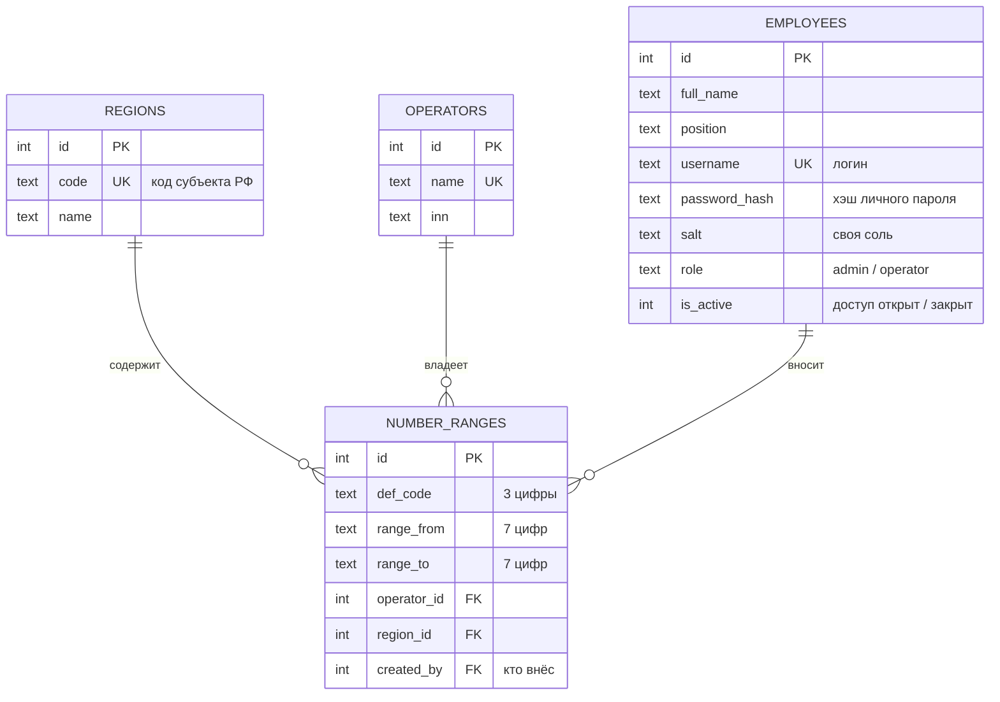

# ER-диаграмма: Россвязь, план нумерации

Связи (все 1:N): регион → диапазоны, оператор → диапазоны, работник → диапазоны (кто внёс).
Таблица `number_ranges` по сути связывает операторов и регионы (M:N).
У каждого работника свой логин и свой пароль (в базе хранится только хэш с индивидуальной солью).
